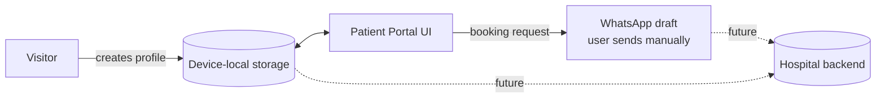
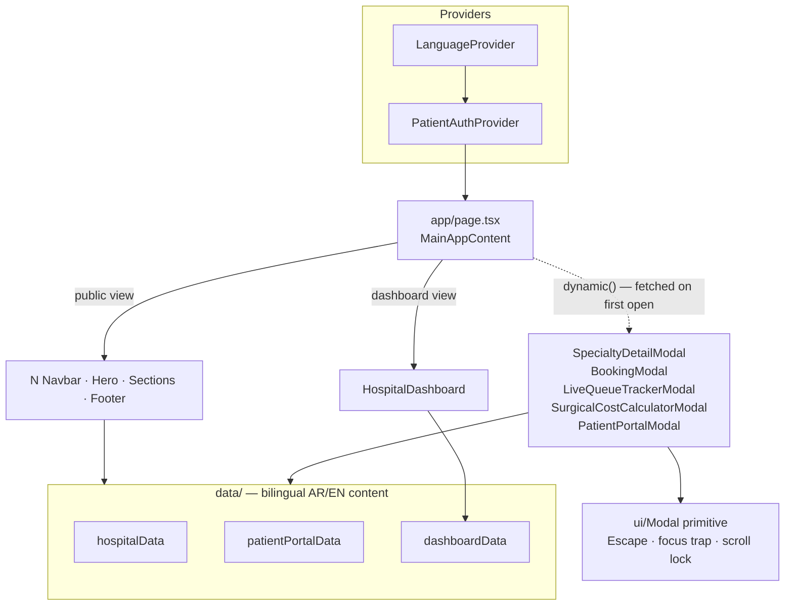

<div align="center">

# 🏥 Konooz Al-Ahram Eye Hospital — Website

**A bilingual (Arabic-first / RTL) marketing site and patient portal for Konooz Al-Ahram
Eye & Surgery Hospital in Benghazi, Libya — built with Next.js 15, React 19, and Tailwind CSS 4.**

[](https://nextjs.org)
[](https://react.dev)
[](https://www.typescriptlang.org)
[](https://tailwindcss.com)
[](#-development)

</div>

> **Note:** Add a hero screenshot at `docs/screenshots/homepage.png` and uncomment below.
>
> ```md
> 
> ```

---

## ✨ Features

| | Feature | Details |
|---|---|---|
| 🌍 | **Bilingual & RTL-first** | Arabic default with instant English toggle; language persists across visits (`localStorage` + `?lang=` deep links) with zero RTL/LTR flash |
| 🦯 | **Accessibility toolbar** | Font scaling, high contrast, reading ruler, and screen-reader-friendly overview |
| 📅 | **Quick booking** | Triage-informed booking form that hands off to WhatsApp with a pre-filled draft |
| 👤 | **Patient portal** | Device-local medical profile: appointments, prescriptions view, notification preferences, newsletter topics |
| ⏱️ | **Queue guidance** | Honest visit-journey guide (live tracking marked *coming soon* until hospital-system integration) |
| 💰 | **Cost estimator** | Surgical cost & insurance co-pay calculator |
| 🔬 | **Vision self-screening** | Interactive acuity check and Amsler grid |
| 🧑‍⚕️ | **Operations dashboard** | Internal staff hub for personnel, rooms, equipment, surgeries, and billing |
| ⚡ | **Performance** | 165 kB first load JS; dashboard and all five modals are lazy-loaded chunks fetched on first open |

## 🔐 Data & Privacy Model

This project makes a deliberate **honesty-first** choice:



- Patient data lives **only in the visitor's browser** — nothing is transmitted to a server.
- There are **no passwords and no fake accounts**: online accounts activate when the hospital
  backend integration ships. The UI says exactly what is (and isn't) stored where.
- WhatsApp alerts open a **pre-filled draft** the user sends themselves — never described as
  automatic delivery.

## 🚀 Quick Start

Prerequisites: **Node.js 18.18+** (Node 20+ recommended), npm.

```bash
# 1. Install dependencies
npm install

# 2. Configure environment (optional — sensible defaults exist)
cp .env.example .env.local

# 3. Start the dev server
npm run dev
```

Open [http://localhost:3000](http://localhost:3000). Arabic renders by default;
append `?lang=en` or use the header switcher for English.

### Production

```bash
npm run build   # static prerender + type/lint checks
npm run start   # serve the production build
```

## ⚙️ Environment Variables

Copy `.env.example` → `.env.local`. All variables are optional in development.

| Variable | Description | Default |
|---|---|---|
| `NEXT_PUBLIC_SITE_URL` | Canonical origin used for SEO metadata & sitemap | `https://konozealahram-eye.ly` |

## 🧱 Tech Stack

| Layer | Choice | Why |
|---|---|---|
| Framework | Next.js 15 (App Router) | Static prerendering, file-based metadata, `next/dynamic` code splitting |
| UI runtime | React 19 | Concurrent rendering, modern hooks patterns |
| Styling | Tailwind CSS v4 | Utility-first, design-token driven theming |
| Language | TypeScript (strict) | Zero `any` escapes in domain types |
| Icons | lucide-react | Consistent, tree-shakeable SVG set |
| Linting | ESLint 9 flat config + jsx-a11y | Accessibility rules enforced at **error** severity |

## 🏗️ Architecture



Key decisions:

- **One shared `components/ui/Modal.tsx` primitive** powers every dialog — Escape-to-close,
  focus trap + restore, body scroll lock, `aria-modal` labelling.
- **Honest state model:** `PatientAuthContext` stores a single device-local profile; there is
  no client-side auth theater. Server features are explicitly labeled as upcoming.
- **Lazy modals:** every modal is rendered conditionally *and* loaded via `next/dynamic`, so
  its JavaScript only downloads when first opened.

## 📂 Project Structure

```
├── app/                  # App Router: layout, page, robots, sitemap, manifest
│   └── layout.tsx        # Pre-paint language script + bilingual metadata
├── components/
│   ├── ui/Modal.tsx      # Shared accessible modal primitive
│   ├── dashboard/        # Operations-hub tabs
│   └── *.tsx             # Public site sections & modals
├── context/
│   ├── LanguageContext.tsx     # AR/EN + RTL, persisted preference
│   └── PatientAuthContext.tsx  # Device-local patient profile
├── data/                 # Bilingual content datasets
├── hooks/                # Shared React hooks
├── lib/                  # Utilities
└── public/images/        # Optimized WebP assets (~828 KB total)
```

## 🗺️ Roadmap

- [x] Bilingual i18n with persistence & pre-paint direction switching
- [x] Honest device-local patient profile (passwords removed pending backend)
- [x] Accessible modal system (focus trap, Escape, scroll lock)
- [x] Lazy-loaded modals & dashboard (165 kB first load)
- [x] Full lint/type-check green (jsx-a11y at error severity)
- [ ] Replace native `alert()` calls with inline form errors
- [ ] Backend integration: real accounts, live queue sync, automated notifications
- [ ] Test infrastructure (unit + E2E)
- [ ] Lighthouse performance pass

## 🤝 Contributing

1. Create a feature branch from `main`.
2. Before opening a PR, ensure both checks pass:

   ```bash
   npm run lint      # must report 0 errors, 0 warnings
   npx tsc --noEmit  # must report 0 errors
   ```

3. Keep commits conventional (`feat: …`, `fix: …`, `docs: …`).

## 📄 License

Proprietary — © Konooz Al-Ahram Eye Hospital. All rights reserved.
Contact [info@konozealahram-eye.ly](mailto:info@konozealahram-eye.ly) for licensing questions.

---

<div align="center">
<sub>Built with ❤️ for the patients of Benghazi · العربية هي اللغة الأساسية للموقع</sub>
</div>
